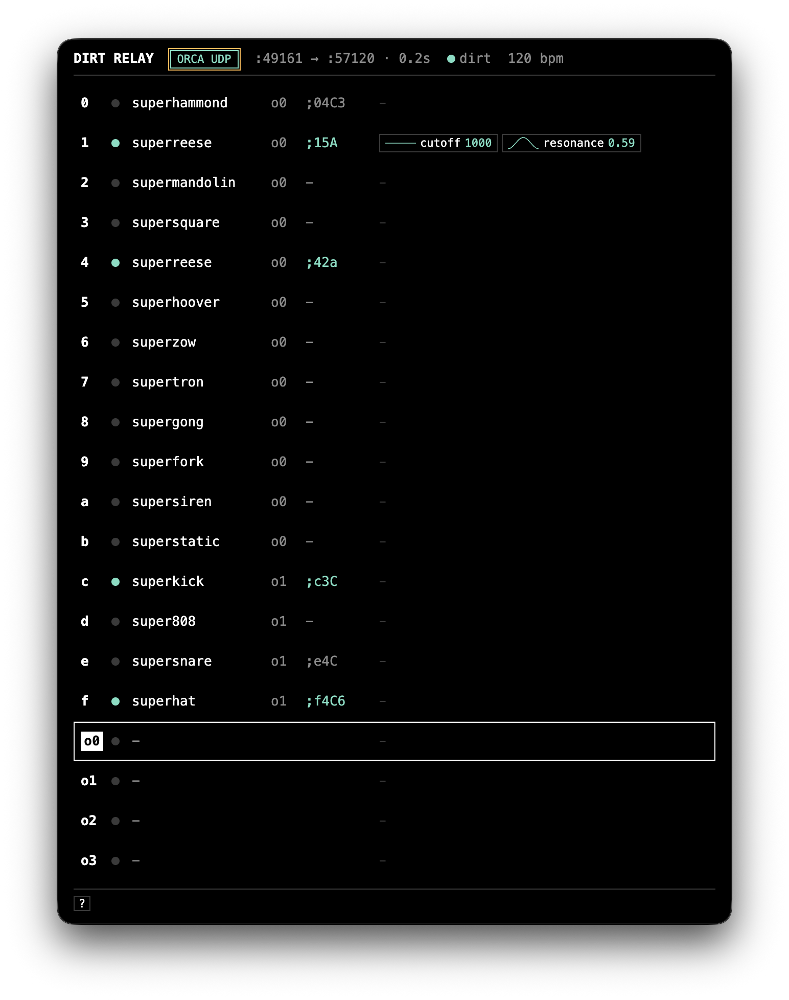

# DirtRelay

DirtRelay は、ORCA 等のシーケンサーから送られる短いメッセージを受け取り、スロット（0〜f）ごとに定義した音色・エフェクト・パラメータ変調を付与して、SuperCollider の **SuperDirt** へ OSC bundle として送出する macOS アプリケーションである。ORCA UDP のほか、汎用 OSC および TidalCycles からの入力にも対応する。



```
ORCA ;04C ──UDP 49161──▶ DirtRelay ──OSC bundle──▶ SuperDirt :57120 ──▶ 音
                             ▲
                       GUI（Electron アプリ）
```

> 状態: v0.2（2026-11）。動作確認環境は macOS 27（Apple Silicon）、SuperCollider 3.14.1、SuperDirt v1.7.3、sc3-plugins 3.14.1。

---

## 使い方

### 起動手順

1. **DirtRelay.app を起動する。**
   - SuperDirt が未起動の場合、アプリがバックグラウンドで起動する（[sc/start_dirt.scd](sc/start_dirt.scd)）。準備完了まで 25〜90 秒を要し、画面上部の `● dirt` が赤から水色に変われば使用可能である。
   - SuperCollider IDE 等で SuperDirt が既に起動している場合は、そちらに接続する。
   - アプリ終了時、アプリが起動した SuperDirt も併せて停止する。
   - メニュー **SuperDirt** から、SuperDirt の開始・再起動・停止、出力デバイスの選択、ログおよびプリセットフォルダの表示を行える。
2. **ORCA を起動する。**
   ```bash
   cd vendor/Orca/desktop && npm start
   ```

ORCA を使わずに音色を確認する場合は、SuperCollider で [sc/listen.scd](sc/listen.scd) を評価した後に `~listen.()` を実行すると、0〜f が順に発音される。

### ORCA での記述

`;` オペレータ（UDP）を用いる。bang は上方から与える（`D` の直下に `*` が出力され、その下の `;` が発火する）。

```
D4....D8....D2....
..................
;04C..;c3C..;f4C8.
```

| 書式 | 意味 |
|---|---|
| `;[slot][octave][note]` | 例 `;04C`：スロット 0、オクターブ 4、C |
| `;[slot][octave][note][velocity][length]` | 例 `;f4C8`：velocity・length は 36 進 1 文字（`0`〜`f` を 0〜1 に対応） |
| note | `C D E F G A B`。小文字はシャープ（`c` = C#） |
| `;bd:3` | サンプル名による直接発音（orbit 0） |
| `;bpm128` | DirtRelay のテンポ（LFO 周期の基準）の変更 |

サンプルパッチ [examples/demo.orca](examples/demo.orca) を ORCA で開くと（File → Open またはウィンドウへのドラッグ）、ビブラフォンの 8 分音符、ベース、キック・スネア・ハット、小節頭のオルガンが再生される。

制約: `;` の文字列は最初の `.` で終端するため、隣接する演算子とは `.` で区切る必要がある。また `-` および `_` は ORCA 上に配置できない。

### 入力プロトコル

画面上部のボタン（または `i` キー）で受信するプロトコルを選択する。選択中のプロトコルのみを受信し、設定は保存される。

| プロトコル | ポート | 用途 |
|---|---|---|
| **ORCA UDP** | 49161 | ORCA の `;` オペレータ（前節の書式） |
| **DirtRelay OSC** | 49162 | Max / Pd / TouchDesigner / Max for Live / Python 等、OSC を送出できるツールからの制御 |
| **Tidal** | 57130 | TidalCycles の中継（「Tidal からの利用」を参照） |

### DirtRelay OSC 仕様

入力を **DirtRelay OSC** に設定した場合にのみ受信する。

#### 通信

| 項目 | 内容 |
|---|---|
| トランスポート | OSC 1.0 over UDP |
| ポート | `49162`（環境変数 `OSC_PORT` で変更可） |
| 送信元 | 制限なし（全ネットワークインターフェースで受信するため、同一 LAN 上の別マシンからも送信可） |
| 受理する型 | `i`（int32）、`f`（float32）、`s` / `S`（文字列）、`d`（double）、`h`（int64）、`T` / `F`（1 / 0 として扱う） |
| bundle | 受理し、内包するメッセージを順に処理する。**タイムタグは参照せず**、受信時刻から DirtRelay のレイテンシ（既定 0.2 秒）後に発音する |
| 応答 | なし |
| 解釈不能なメッセージ | 破棄する（画面上部に `- ` 付きで表示） |

#### アドレス一覧

| アドレス | 引数 | 概要 |
|---|---|---|
| `/dirtrelay` | 文字列（可変長） | ORCA UDP と同一のテキスト書式 |
| `/dirtrelay/note` | slot octave semitone [velocity length] | 数値による発音 |
| `/dirtrelay/play` | slot [key value …] | スロットの発音と任意パラメータの上書き |
| `/dirtrelay/bpm` | bpm | テンポの変更 |
| `/dirt/play` | key value … | SuperDirt 命令の直接中継 |

**`/dirtrelay` ⟨文字列…⟩**

- 文字列引数 1 つが 1 メッセージに相当する（1 つの文字列内を `;` で区切ってもよい）。
- 書式は「ORCA での記述」と同一である：`"04C"`、`"f4C8"`（velocity 8/15）、`"bd:3"`、`"bpm128"`。
- 例：`/dirtrelay "04C" "c3C"`

**`/dirtrelay/note` ⟨slot:int⟩ ⟨octave:int⟩ ⟨semitone:int⟩ [⟨velocity:float⟩ ⟨length:float⟩]**

| 引数 | 範囲 | 意味 |
|---|---|---|
| slot | 0〜15 | スロット番号 |
| octave | 0〜8 | オクターブ |
| semitone | 0〜11 | 半音（0 = C、1 = C#、… 11 = B） |
| velocity | 0〜1（省略可） | 音量。`amp = 0.6 × velocity` として送出する |
| length | 0〜1（省略可） | 音長（1 = 1 小節）。シンセにのみ `sustain` として適用し、省略時はスロットの `sus` を用いる |

- 音高は `note = semitone + (octave − 5) × 12` として送出する（octave 5 の C が note 0 = MIDI 60）。
- サンプルのスロットでは、音高を再生速度 `speed = 2^(note/12)` に変換する。
- 例：`/dirtrelay/note 1 5 4 0.5` → スロット 1 で E5、velocity 0.5

**`/dirtrelay/play` ⟨slot⟩ [⟨key:string⟩ ⟨value⟩ …]**

- slot は数値（`3`）または 36 進の文字（`"c"`）で指定する。
- 後続の key / value は SuperDirt のパラメータ名と値である（`cutoff`、`room`、`speed`、`n`、`gain`、`vowel` 等。一覧は [docs/01](docs/01_SuperDirt受信仕様.md) §4）。
- 優先順位：**本メッセージの値 ＞ orbit ミキサー ＞ スロット設定**
- `note` は音高として扱う（省略時 0）。
- 上書きされた値は、編集画面の out 欄に下線付きで表示される。
- 例：`/dirtrelay/play 3 note 7 cutoff 900 room 0.3`

**`/dirtrelay/bpm` ⟨bpm:number⟩**

- DirtRelay のテンポ（LFO 周期および length の基準）を設定する。20 以上の値を整数に丸めて適用する。
- 例：`/dirtrelay/bpm 128`

**`/dirt/play` ⟨key:string⟩ ⟨value⟩ …**

- スロットおよび orbit ミキサーの設定を適用せず、SuperDirt へそのまま中継する。SuperDirt の全機能を直接利用できる。
- DirtRelay のレイテンシを付与した bundle として送出する。数値は float とする（`orbit` と `cut` のみ int）。
- 例：`/dirt/play s "bd" n 3 orbit 1 room 0.3`

#### 送信例

Python（[python-osc](https://pypi.org/project/python-osc/)）：

```python
from pythonosc.udp_client import SimpleUDPClient
c = SimpleUDPClient("127.0.0.1", 49162)
c.send_message("/dirtrelay", "04C")
c.send_message("/dirtrelay/note", [1, 5, 4, 0.5])
c.send_message("/dirtrelay/play", [3, "note", 7, "cutoff", 900.0])
c.send_message("/dirt/play", ["s", "bd", "n", 3, "orbit", 1])
```

- Pd（vanilla）：`[3 note 7 cutoff 900(` → `[oscformat dirtrelay play]` → `[list prepend send]` → `[list trim]` → `[netsend -u -b]`（`[connect 127.0.0.1 49162(` で接続）。Pd は数値を float で送出するが、slot 等は受信側で整数に丸める。
- Max：`[udpsend 127.0.0.1 49162]` に `/dirtrelay/play 3 note 7 cutoff 900` を送る。

### Tidal からの利用（Tidal → DirtRelay → SuperDirt）

1. DirtRelay の入力を **Tidal** に切り替える（上部のボタンまたは `i`）。
2. [tidal/BootTidal.hs](tidal/BootTidal.hs) で Tidal を起動する。既存の BootTidal.hs を用いる場合は、`superdirtTarget` の `oPort = 57120` を **`oPort = 57130`** に変更する。
3. 通常どおり `d1 $ s "bd*4"` 等を記述する。Tidal に `Connected to SuperDirt.` が表示されれば接続済みである。

DirtRelay の処理内容:

- Tidal の bundle を**タイムタグを保持したまま** SuperDirt へ転送し、ハンドシェイクの応答を Tidal へ返す。追加設定がなければ完全な透過中継となり、SuperDirt の全機能を利用できる。
- 受信内容を画面上部に `d1 s bd n 3 orbit 0` の形式で表示する。
- **orbit ミキサー**（o0〜o3）で有効化したパラメータを、該当 orbit の Tidal の音に付加する。Tidal 側で同名のパラメータが指定されている場合は DirtRelay の値で上書きする。
- コントロールバス（`^cutoff` 等の `/c_set`）は従来どおり Tidal から scsynth（57110）へ直接送られる。

SuperDirt は DirtRelay が起動するため、SuperCollider IDE で別途起動する必要はない。確認環境は Tidal 1.9.4。通信仕様は [docs/03_Tidal通信仕様.md](docs/03_Tidal通信仕様.md) を参照。

### orbit

orbit は SuperDirt におけるトラックに相当し、orbit ごとにリバーブ（room / size）とディレイ（delay / delaytime / delayfeedback）を 1 系統ずつ持つ。

1. **スロットの送出先 orbit を設定する**：編集画面の `orbit` 欄（`o` キー）。既定値は 0〜b が orbit 0、c〜f（打楽器）が orbit 1。
2. **orbit のエフェクトを設定する**：一覧下部の `o0`〜`o3` 行を選択し（`↓` で移動）、`Enter` で開く。`n` で room 等を追加し、`Space` で有効化する。LFO も適用できる。
3. 設定値は、その orbit 宛ての全ての音に自動で付加される。

例：o0 に `room 0.4 / size 0.8` を設定して上モノのみに残響を付け、o1（打楽器）はドライのまま保つ。

orbit 単位で設定する理由: SuperDirt では room や delay が orbit ごとに 1 つしか存在しない。同一 orbit にリバーブの有無が異なる音が混在すると、到着順に設定が上書きされ互いに打ち消し合う（[docs/01](docs/01_SuperDirt受信仕様.md) §4.6 の実測）。

### 出力デバイス

SuperCollider の出力先は**サーバー起動時点のデバイスに固定**される。Apple Silicon の Mac では「スピーカー」と「外部ヘッドフォン」が別デバイスとして扱われるため、起動後にイヤフォンを接続しても出力はスピーカーに残る。

- **システム既定に追従させる**：出力先の変更後、メニュー SuperDirt → Restart SuperDirt で再起動する。
- **出力先を固定する**：メニュー SuperDirt → Output Device でデバイスを選択すると、SuperDirt がそのデバイスで再起動する。選択は保存され、次回起動時にも適用される。新たに接続したデバイスが一覧にない場合は Rescan Devices を実行する。
- アプリ以外（SuperCollider IDE 等）で SuperDirt を起動している場合、この設定は適用されない。IDE 側で `s.options.outDevice = "デバイス名";` を指定する（一覧は `ServerOptions.outDevices.postln;`）。

### 画面構成

**一覧画面**：1 行が 1 スロットに対応する。

```
0 ● superhammond  o0  ;04C   [∿ cutoff 1519] [— resonance -]
```

左から、スロット番号、受信インジケータ、音源、orbit、最終受信文字列、パラメータを表示する。パラメータは波形アイコンと現在値で示し、無効なものは点線・グレーで表示する。下段は orbit 0〜3 のミキサー（room / delay 等）である。

**編集画面**：`Enter` またはダブルクリックで開き、`←` または `Esc` で一覧に戻る。

- 上段：sound（シンセ 37 種〔sc3-plugins なしでは 30 種〕およびサンプル全バンク）、`n`（サンプル番号）、orbit、sus（シンセの音長）
- パラメータ行：`名前｜●/○（有効/無効）｜波形｜bars（1 周期の小節数）｜min｜max｜×`
  - 波形：`—` 固定、`∿` sine、`⟋` saw、`△` tri、`⊓` square、`⁘` rand、`≈` perlin
  - 例：Tidal の `cutoff (range 300 3000 (slow 4 sine))` は `cutoff ● ∿ 4 300 3000` の 1 行で表現される。
  - 無効のパラメータは送出しないが、設定は保持され編集も可能である。事前に設定しておき、演奏中に有効化する運用を想定している。
- 右側：受信ログ（in）と、実際に送出した `/dirt/play`（out）

設定は自動保存される。保存先はアプリでは `~/Library/Application Support/DirtRelay/presets/current.json`、`npm run relay` では `hub/presets/current.json` である。

### 環境変数

| 変数 | 既定値 | 内容 |
|---|---|---|
| `IN_PORT` | 49161 | ORCA UDP の受信ポート（ORCA `;` の既定送信先） |
| `OSC_PORT` | 49162 | DirtRelay OSC の受信ポート |
| `TIDAL_PORT` | 57130 | Tidal 中継の受信ポート（Tidal の `oPort` に指定） |
| `DIRT_HOST` / `DIRT_PORT` | 127.0.0.1 / 57120 | SuperDirt の送信先 |
| `HTTP_PORT` | 49170 | GUI 用の内部 HTTP サーバー |
| `LATENCY` | 0.2（プリセットに保存） | SuperDirt へ送る bundle の先行時間（秒）。GUI の `[` `]` でも変更可 |
| `DIRT_SAMPLES` | `~/Library/Application Support/SuperCollider/downloaded-quarks/Dirt-Samples` | サンプル一覧の読み込み元 |

```bash
LATENCY=0.1 npm start
```

---

## インストール

### 動作要件

| ソフトウェア | 確認バージョン | 備考 |
|---|---|---|
| macOS | 27 / Apple Silicon | |
| [SuperCollider](https://supercollider.github.io/) | 3.14.1 | `brew install --cask supercollider`。3.13 以降を推奨（Apple Silicon ネイティブ。3.12 以前は Rosetta 上で動作し、音切れが生じやすい） |
| SuperDirt（quark） | v1.7.3 | 後述の手順で導入する |
| [sc3-plugins](https://github.com/supercollider/sc3-plugins/releases) | 3.14.1 | 任意。superpiano・supersaw・superfm 等 7 種のシンセおよび追加エフェクトに必要。SuperCollider と同一バージョンを用いる |
| Node.js | 18 以上（確認は 22） | |
| [ORCA](https://github.com/hundredrabbits/Orca) | desktop 版 | 第三者のリポジトリであるため本リポジトリには同梱しない |

### 1. SuperDirt

SuperCollider を起動し、以下を一度だけ実行する。サンプル（Dirt-Samples）のダウンロードに数分を要する。

```supercollider
Quarks.checkForUpdates({ Quarks.install("SuperDirt", "v1.7.3"); thisProcess.recompile() })
```

#### sc3-plugins（任意）

[リリースページ](https://github.com/supercollider/sc3-plugins/releases) から SuperCollider と同一バージョンの `sc3-plugins-<版>-macOS.zip`（universal 版）を取得し、内部の `SC3plugins` フォルダを以下に配置する。

```bash
open ~/Library/Application\ Support/SuperCollider/Extensions
```

- 旧版の sc3-plugins（Intel 専用版等）が存在する場合は、`Extensions` 外へ移動してから差し替える。同一クラスが重複すると SuperCollider がエラーとなる。
- 未導入でも DirtRelay は動作する（super* シンセのうち 25 種が利用可能）。

### 2. DirtRelay（ビルド）

```bash
git clone https://github.com/spktrjp/DirtRelay.git
```

```bash
cd DirtRelay && npm install && npm run dist
```

`dist/DirtRelay-darwin-arm64/DirtRelay.app` が生成されるので、`/Applications` にコピーする。

- 本アプリは未署名である。別の Mac で初回起動する際は、右クリック →「開く」で起動する。
- `npm start` でビルドせずにアプリとして起動できる（開発用）。中継部のみを動作させる場合は `npm run relay` を用いる（Node.js 標準ライブラリのみで動作し、GUI は `http://127.0.0.1:49170/` をブラウザで開く）。

### 3. ORCA

`vendor/Orca` に取得する（`.gitignore` 済み）。

```bash
cd DirtRelay && git clone https://github.com/hundredrabbits/Orca vendor/Orca
```

```bash
cd vendor/Orca/desktop && npm_config_arch=x64 npm install
```

`npm_config_arch=x64` を指定するのは、ORCA が依存する Electron 8 に Apple Silicon 版が存在しないためである（Rosetta 上で動作する）。itch.io 版の ORCA を用いる場合、この手順は不要である。

---

## トラブルシューティング

| 症状 | 対処 |
|---|---|
| `● dirt` が赤のまま変わらない | 起動直後であれば最大 90 秒程度待つ。改善しない場合は、メニュー SuperDirt → Open SuperDirt Log でログを確認するか、Restart SuperDirt を実行する |
| scsynth が `Found 0 LADSPA plugins` で停止する | 入力デバイス（マイク）を開けていない。`start_dirt.scd` は入力 0ch に設定済みである。IDE から起動してマイクを許可するか、入力 0ch のまま使用する |
| superpiano / supersaw / superfm 等が発音しない | sc3-plugins が必要である（「sc3-plugins（任意）」参照）。未導入でもその他の super* 25 種は発音する。アプリが起動する SuperDirt も `~/Library/Application Support/SuperCollider/Extensions` の sc3-plugins を読み込む |
| `ERROR: Class not defined` が十数行出力される | sc3-plugins が存在しない環境で、`start_dirt.scd` が依存シンセの読み込みを省略した結果であり、動作に影響はない |
| 音が断続的に途切れる・遅れる | SuperCollider 3.12 以前（Intel 版、Rosetta 上で動作）の間欠的な停止が原因である。3.13 以降（Apple Silicon ネイティブ）へ更新する（実測：3.12 では 90 秒間に 21 回、3.14.1 では 0 回）。更新できない場合は `]` でレイテンシを 0.5 秒程度に上げる |
| イヤフォン接続後に音が聞こえない | 「出力デバイス」を参照。Restart SuperDirt を実行するか、Output Device で出力先を選択する |
| ORCA の `npm install` が 404 で失敗する | `npm_config_arch=x64` を付けて実行する |
| 「UDP 49161 … in use」と表示されアプリが終了する | 49161 を使用する他のアプリ（Pilot 等）を終了するか、`IN_PORT` を変更する（ORCA 側の送信先も合わせる） |

---

## キーアサイン

`?` キーで画面上にも一覧を表示できる。

### メニュー

| キー | 動作 |
|---|---|
| `Cmd+Shift+R` | SuperDirt の再起動 |

### 一覧画面

| キー | 動作 |
|---|---|
| `0`–`f` / `↑` `↓` | スロット選択 / 移動（orbit 行まで） |
| `Enter` | 編集画面を開く |
| `t` | 選択スロットの試聴 |
| `m` | ミュート / 解除 |
| `Space` | スロットの全パラメータを一括で有効 / 無効 |
| `,` `.` | BPM −1 / +1 |
| `i` | 入力プロトコルの切り替え（ORCA UDP → DirtRelay OSC → Tidal） |
| `[` `]` | レイテンシ −0.05 / +0.05 秒 |

### 編集画面

| キー | 動作 |
|---|---|
| `↑` `↓` / `←` `→` | 行 / 列（有効・波形・bars・min・max）の移動 |
| `Space` | 有効 / 無効 |
| `-` `=` | 値の減少 / 増加（波形欄では種類の切り替え）。Shift 併用で変化量を大きくする |
| `Enter` | 欄への直接入力（再度 `Enter` で確定） |
| `n` / `x` | パラメータの追加 / 削除 |
| `s` / `o` | sound 欄 / orbit 欄へ移動 |
| `t` / `m` | 試聴 / ミュート |
| `0`–`f` | 別スロットの編集画面へ移動 |
| `Esc` | 一覧画面に戻る |

---

## フォルダ構成

| パス | 内容 |
|---|---|
| `electron/main.js` | アプリ本体（中継部の起動、ウィンドウ、SuperDirt の自動起動・停止、メニュー） |
| `hub/server.js` | 中継部（UDP / OSC 受信 → 解釈 → OSC bundle 送信、HTTP + SSE） |
| `hub/public/` | GUI（`index.html`）と、サーバー・GUI 共通の波形計算（`wave.js`） |
| `hub/presets/` | 設定の保存先（`npm run relay` 時） |
| `sc/` | SuperDirt の起動・試聴スクリプト |
| `tidal/BootTidal.hs` | DirtRelay 経由で Tidal を用いるための BootTidal |
| `docs/` | 通信仕様（ORCA・SuperDirt・Tidal）、要件、画面モック |
| `vendor/Orca/` | ORCA（各自で取得。git 管理外） |

## 今後の予定

- ORCA `=`（整数 OSC）および MIDI の受信
- Pilot の音色命令（OSC / ENV / エフェクト）の読み替え
- プリセットの切り替え
- 汎用 OSC / UDP 入力の拡充

---

## コンセプト

DirtRelay は、**ORCA で TidalCycles のような音を鳴らすためのツール**である。

TidalCycles は SuperDirt を音源とし、豊富なシンセ・サンプル・エフェクトを、パターンと連続的なパラメータ変化によって制御する。一方 ORCA は、2 次元グリッド上のオペレータによって「いつ・どの音を鳴らすか」を記述することに特化したシーケンサーである。DirtRelay はこの両者を接続し、ORCA の記述性と SuperDirt の音響表現を組み合わせることを目的とする。

### 直接接続できない理由

ORCA を SuperDirt に直接接続しても発音しない。

- ORCA の OSC（`=`）はアドレスが 1 文字、引数が整数のみであり、`/dirt/play s bd` のような「音名＋パラメータ」の命令を構成できない。
- ORCA の UDP（`;`）は文字列を送出できるが、最大 36 文字で、使用可能な記号も限られる。
- SuperDirt はタイムスタンプのない命令を即時実行として扱い、`late` 警告を出力する。

詳細は [docs/00_通信仕様比較.html](docs/00_通信仕様比較.html) および [docs/01_SuperDirt受信仕様.md](docs/01_SuperDirt受信仕様.md) を参照。

### 役割分担

- **ORCA**：発音のタイミング、スロット、音高を決定する。
- **DirtRelay**：音色の割り当て、エフェクト、パラメータの時間変化（LFO）を付与する。
- **SuperDirt**：発音を担う。

### ORCA にない概念の補完

DirtRelay は、ORCA 単体では扱えない SuperDirt / Tidal 由来の概念を、一定の範囲でサポートする。

- **orbit**：SuperDirt のトラック単位。スロットごとに送出先 orbit を割り当て、orbit 単位でリバーブ・ディレイを設定する。
- **連続的なパラメータ変化**：Tidal の `range … (slow n sine)` に相当する変調を、波形（sine / saw / tri / square / rand / perlin）・周期（小節数）・範囲（min / max）でパラメータごとに指定する。
- **パラメータの選択的送出**：Tidal と同様に、設定したパラメータのみを送出する。

### 設計方針

- **16 スロット（0〜f）**：Pilot（Hundred Rabbits のシンセ）と同一の書式 `;04C` を採用し、先頭 1 文字をスロットとする。既存の ORCA パッチをそのまま利用できる。
- **ライブパフォーマンスを前提とした UI**：0〜f を 1 画面に一覧し、受信値を確認しながらその場で割り当てを変更できる。幅 960px とし、Full HD 画面の片側に ORCA と並べて配置できる。
- **キーボードによる全操作**：ORCA と同じ思想に基づく。マウス操作にも対応する。
- **正確なタイミング**：全ての命令を OSC bundle（受信時刻＋レイテンシ）として送出する。
- **外部依存なし**：中継部は Node.js 標準ライブラリのみで動作する。

---

## ライセンス

[MIT License](LICENSE)。ORCA（Hundred Rabbits）は同梱しない（各自で取得すること。ORCA 自体も MIT License である）。
